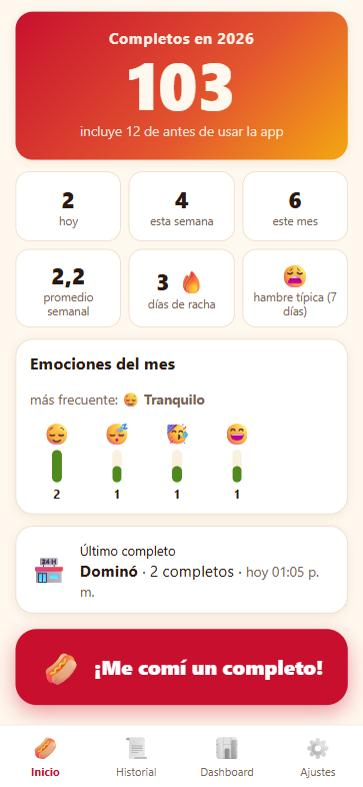
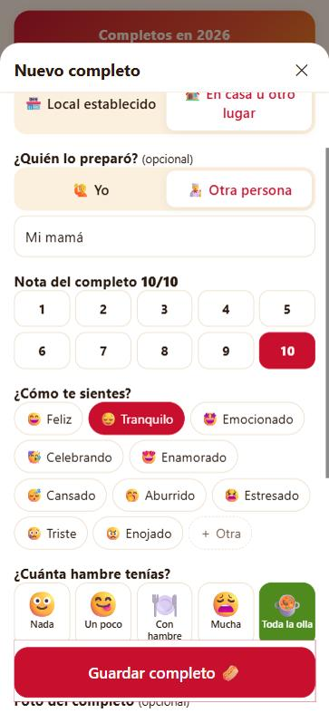
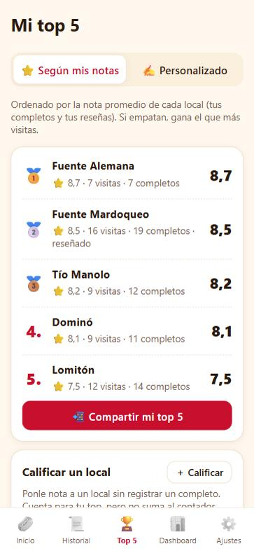

# 🌭 Completómetro

Lleva la cuenta de todos los completos que te comes en el año. Una app web instalable (PWA):
gratis, sin tiendas de apps, sin cuentas y **sin internet**. Tus datos se quedan en tu teléfono.

- Registrar un completo toma segundos: cantidad, tipo (italiano, dinámico, luco… y si es 🌱 veggie),
  dónde (local o en casa, y quién lo preparó), nota
  del completo (1–10), emoción, nivel de hambre (de "nada" a "me comería toda la olla"), foto y
  ubicación automática. Al escribir el local, sugiere locales cercanos de OpenStreetMap.
- Resumen al abrir: total del año, hoy/semana/mes, promedio semanal, racha y emociones del mes.
- Dashboard: gráficos por semana o por mes, mapa de tus completos, ranking de locales y emociones.
- **Mi top 5** de locales: según tus notas (si empatan, gana el más visitado) o armado a mano.
  Puedes calificar un local sin registrar un completo, y ver un mapa de calor de dónde comes más.
- **Resumen del año** para compartir en historias de Instagram (banner desde el 31 de diciembre).
- Plantillas estilo boleta retro para historias: **"Mi top 5"**, **"Mi completo favorito"** (en blanco,
  para rellenar y etiquetar al local) y **"Mi contador"** (con tu número o en blanco, ideal si recién empiezas).
- Exporta a **CSV/ZIP para Power BI o Excel** y respalda en Drive, iCloud, WhatsApp o correo.

<p align="center">
  
  
  
  
</p>

Más capturas (con datos ficticios): [docs/CAPTURAS.md](docs/CAPTURAS.md).

## 📲 Deja la app en tu pantalla de inicio

Es como tener una app más, pero sin pasar por la tienda de apps. Toma menos de un minuto.
Primero abre este link en el teléfono: **https://joaco2v.github.io/completometro/**

### Con Chrome en Android

1. Abre el link en **Chrome**.
2. Toca los **tres puntitos ⋮** que están arriba a la derecha.
3. Busca **"Agregar a la pantalla principal"** (en algunos teléfonos dice **"Instalar app"**) y tócalo.
4. Dale a **"Instalar"** o **"Agregar"**.
5. ¡Y listo! 🎉 Te queda el ícono del completo junto a tus otras apps.

### Con Chrome en iPhone

1. Abre el link en **Chrome**.
2. Toca el botón de **compartir** (el cuadradito con la flechita hacia arriba ⬆️), en la barra de la dirección, arriba a la derecha.
3. Baja un poco en el menú y toca **"Agregar a pantalla de inicio"**.
4. Toca **"Agregar"**, arriba a la derecha. ¡Listo! 🎉

¿No te aparece la opción? Actualiza tu iPhone o hazlo desde Safari.

### Con Safari en iPhone

1. Abre el link en **Safari** (la brújula azul 🧭).
2. Toca el botón de **compartir** (el cuadradito con la flechita hacia arriba ⬆️), abajo al medio.
   Si no lo ves, toca los **tres puntitos ···** de abajo y ahí aparece "Compartir".
3. Desliza hacia abajo y toca **"Agregar a pantalla de inicio"**.
4. Si aparece **"Abrir como app web"**, déjalo activado. Después toca **"Agregar"**. ¡Listo! 🎉

> 💡 **Importante:** desde ahora ábrela siempre desde el ícono 🌭 y no desde el navegador.
> En el iPhone, la app instalada y el navegador guardan los datos por separado, así que lo que
> anotes en uno no aparece en el otro. Si ya tenías completos anotados en el navegador, respáldalos
> antes y luego impórtalos (o conecta Google Drive) en la app instalada.
> Además, Safari puede borrar los datos de páginas que no están instaladas y que no abres en una semana.
>
> ¿Usas otro navegador (Samsung Internet, Firefox, Edge…)? Copia el link y ábrelo en Chrome o Safari.

### Primeros pasos

- En **Ajustes › Contador inicial**, anota cuántos completos llevabas este año antes de usar la app.
- Toca **"¡Me comí un completo!"** cada vez. Si se te olvidó registrar uno, usa
  **"Cambiar (me olvidé de anotarlo)"** para ponerle la fecha y hora reales.
- La primera vez, el teléfono pedirá permiso de **ubicación**. Si lo niegas, puedes marcar el lugar en el mapa.
- En el **Historial** cada registro tiene ✏️ para editarlo y 🗑️ para eliminarlo. Con **☑️ Seleccionar**
  puedes marcar varios (o un mes completo) y editarlos o eliminarlos de una vez (por ejemplo,
  ponerles la misma nota o moverlos a otro día). Lo eliminado queda en
  **Eliminados**, al final del historial, por si te arrepientes.
- Para empezar de cero: **Ajustes › Eliminar todos los registros** (te pide escribir BORRAR para confirmar).

### Respaldo (Ultra importante)

Los datos viven solo en tu teléfono. En **Ajustes › Respaldo** tienes la guía paso a paso.
Lo más cómodo es **Conectar con Google**: la app guarda sola una copia privada en tu Google Drive
después de cada cambio, y en un teléfono nuevo basta con conectarse con la misma cuenta.
También puedes hacerlo a mano: **Guardar copia** abre el menú de compartir del teléfono → elige Google Drive, "Guardar en Archivos"
(iCloud), WhatsApp o correo. Para cambiar de teléfono: instala la app en el nuevo y toca
**Importar respaldo**. La app te recordará respaldar de vez en cuando.
Opciones y planes de respaldo automático: [docs/RESPALDO.md](docs/RESPALDO.md).

## 📊 Usar los datos en Power BI

1. En la app: **Ajustes › Exportar ZIP**. Descomprímelo.
2. Power BI Desktop: **Obtener datos › Texto/CSV** › `completos.csv`.
3. El archivo es UTF-8 con BOM, separado por comas, con decimales con punto y fechas ISO.
   Si Power BI está en español y lee mal los decimales, en el editor de Power Query cambia el tipo
   de `latitud`/`longitud` con **"Usar configuración regional" › Inglés (Estados Unidos)**.
4. Para el **mapa**: visual de Mapa con `latitud` en Latitud y `longitud` en Longitud.
5. La columna `foto_archivo` indica qué imagen de la carpeta `fotos/` corresponde a cada fila.

Para probar sin datos reales: [ejemplos/completos_ejemplo.csv](ejemplos/completos_ejemplo.csv) (datos ficticios).

| Columna | Descripción |
|---|---|
| `id` | Identificador único del registro |
| `fecha_hora` | ISO 8601 con zona horaria (`2026-01-09T13:20:00-03:00`) |
| `fecha`, `hora`, `anio`, `mes`, `semana_inicio` | Para agrupar fácil (semana = lunes) |
| `numero_acumulado_anio` | N° de completo del año (incluye el contador inicial) |
| `cantidad` | Completos en ese registro |
| `tipo_lugar` | "Local establecido" / "En casa u otro lugar" |
| `nombre_local` | Solo locales |
| `puntuacion` | Nota del completo, de 1 a 10 (en cualquier lugar) |
| `tipo_completo` | Completo, Italiano, Dinámico, Luco, As, Chacarero, Especial, Vienesa sola u otro escrito a mano |
| `veggie` | "Sí" si la vienesa era vegetal 🌱, si no "No" |
| `preparado_por`, `preparado_por_nombre` | Solo en casa u otro lugar: "Yo" / "Otra persona" y su nombre (opcional) |
| `emocion`, `emocion_emoji` | Emoción (etiqueta, sin valor numérico) |
| `hambre_nivel`, `hambre_texto` | 1 = nada … 5 = me comería toda la olla |
| `latitud`, `longitud`, `precision_gps_m`, `origen_coordenadas` | `gps`, `foto_exif` o `manual` |
| `foto_archivo`, `notas` | |

El ZIP también trae **`resenas_locales.csv`**: los locales que calificaste sin registrar un completo
(`id`, `fecha`, `nombre_local`, `puntuacion`, `latitud`, `longitud`, `comentario`).

## 🍴 Haz tu propia copia (fork)

Cada persona que use tu link tiene sus propios datos en su teléfono (la app parte vacía).
Si igual quieres tu propia versión:

1. Crea una cuenta en GitHub (gratis) y toca **Fork** en este repositorio.
2. En tu fork: **Settings › Pages › Build and deployment › Source: GitHub Actions**.
3. Ve a **Actions**, habilita los workflows y ejecuta **"Publicar en GitHub Pages"** (o haz cualquier commit en `main`).
4. En unos minutos tu app queda en `https://<tu-usuario>.github.io/<nombre-del-repo>/`.
   Funciona con cualquier nombre de repositorio, no hay que configurar rutas.
5. En `src/config.ts`, cambia `autor` y `repositorio` por tus datos (se muestran en "Acerca del Completómetro").
6. Opcional: activa el respaldo en Google Drive creando tu propio ID de cliente ([docs/GOOGLE_DRIVE.md](docs/GOOGLE_DRIVE.md)).

## 🛠️ Desarrollo

Requisitos: [Node.js](https://nodejs.org) 22 o superior.

```bash
npm install
npm run dev        # servidor de desarrollo
npm test           # pruebas (métricas, CSV, importación, conflictos)
npm run build      # versión de producción en dist/
npm run preview    # sirve dist/ (incluye service worker)
node scripts/generar-iconos.mjs   # regenera los íconos
```

Para probar en el teléfono durante el desarrollo, la ubicación y la instalación necesitan **https**:
lo más simple es publicar en GitHub Pages, o usar `npm run dev -- --host` en la misma red WiFi
(sin https el GPS no funciona, pero el resto sí).

### Stack

Vite + TypeScript + Preact · IndexedDB con `idb` · Leaflet + OpenStreetMap · uPlot (gráficos) ·
JSZip · exifr (GPS de las fotos) · vite-plugin-pwa (offline) · Vitest.
El dashboard, el mapa y el ZIP se cargan solo cuando se usan: el inicio pesa ~30 KB comprimido.

### Arquitectura

```
src/
├─ dominio/      Reglas puras y testeables: modelo, métricas, acumulado, conflictos, emociones, ajustes
├─ datos/        Contratos (RegistroRepository, FotoStorage, AjustesStore, Outbox),
│                implementación local IndexedDB con migraciones, CSV y respaldo
├─ servicios/    Navegador: ubicación, EXIF, compresión de fotos, compartir, instalación, imagen anual
└─ interfaz/     Pantallas (Inicio, Historial, Dashboard, Ajustes) y componentes
```

- Las pantallas **nunca** tocan IndexedDB: usan las interfaces de `datos/contratos.ts`.
- Cada registro tiene UUID, `creado_en`, `actualizado_en`, `eliminado_en` (borrado lógico) y
  `dispositivo_id`. Cada cambio queda en un **outbox** listo para sincronizar el día que haya backend.
- Conflictos: **gana el último cambio** según `actualizado_en`.
- Esquema versionado: las migraciones de IndexedDB están en `src/datos/local/db.ts`.
- Configuración por `.env` (`VITE_MODO=local|remoto`, `VITE_BACKEND_URL`). Sin `.env`, 100 % local.
- Contrato de API para el backend futuro: [docs/BACKEND.md](docs/BACKEND.md).

## Cómo nació

En 2025, un amigo usó un grupo de WhatsApp consigo mismo para anotar cada completo que se comía, y a
fin de año publicó el total. Le copié la idea y empecé a hacer lo mismo (¡gracias, Gustavo!). Se lo conté a Valentina, una
amiga, y me dijo que podía agregarle métricas e insights para tener un análisis muy bacán. De ahí salió
el Completómetro. ¡Gracias, Vabe!

## ¿Quieres apoyar?

Es un proyecto personal que hago por hobby. Si quieres ayudar con el desarrollo o el mantenimiento,
proponer una idea o reportar un problema, abre un [issue](https://github.com/joaco2v/completometro/issues)
o escríbeme por [GitHub](https://github.com/joaco2v). Los pull requests son bienvenidos.

## Licencia

[MIT](LICENSE): puedes usar, copiar, modificar y compartir el código libremente, manteniendo el aviso
de licencia y el crédito.

## Privacidad

Sin servidores propios, sin analítica, sin publicidad. De internet solo se usan los mapas de
OpenStreetMap, las sugerencias de locales (se envía lo que escribes en "Nombre del local" y una
ubicación aproximada al servicio Photon de OpenStreetMap) y, si lo conectas, tu Google Drive. Tus datos salen del teléfono solo cuando tú exportas o respaldas.

Política de privacidad completa: <https://joaco2v.github.io/completometro/privacidad.html>
Términos del servicio: <https://joaco2v.github.io/completometro/terminos.html>
([public/terminos.html](public/terminos.html))
(el archivo está en [public/privacidad.html](public/privacidad.html); si haces un fork, cambia el autor y los enlaces).
