# Capturas del Completómetro

Capturas de la versión 0.4.0 en tamaño de teléfono, tomadas durante las pruebas con **datos ficticios**
(los registros, locales y nombres son de ejemplo).

## Inicio y registro

| Inicio | Registrar un completo | Sugerencias de locales |
|:-:|:-:|:-:|
| 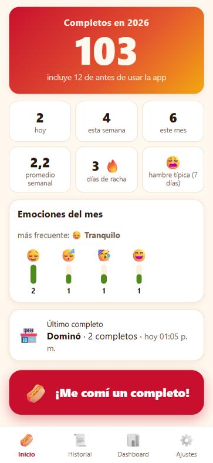 | 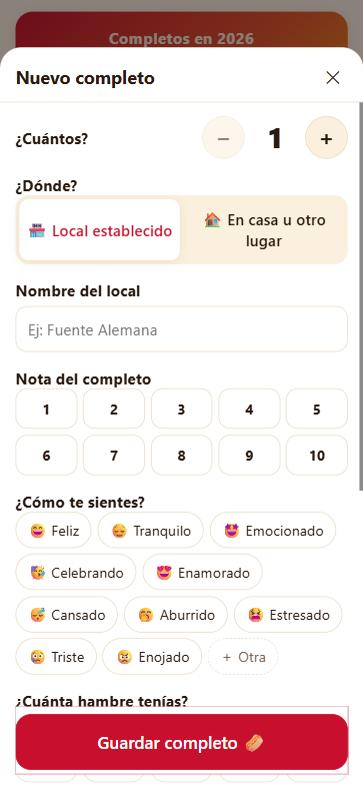 | 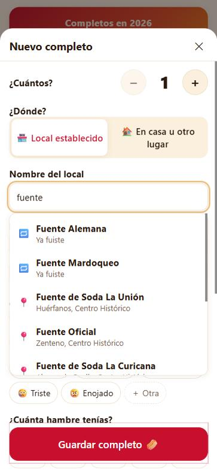 |
| Total del año, hoy/semana/mes, promedio, racha, hambre y emociones del mes. | Cantidad, lugar, nota del completo (1–10) y emoción. | Primero los locales donde ya fuiste; luego los cercanos de OpenStreetMap. |

| En casa y hambre | Historial |
|:-:|:-:|
| 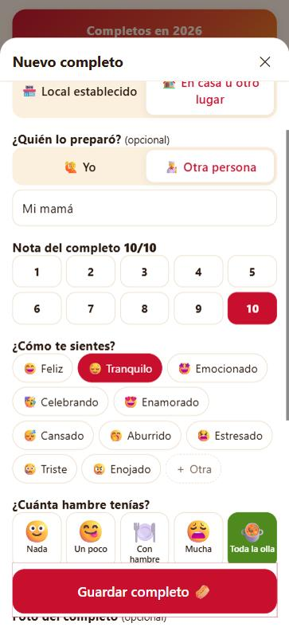 | 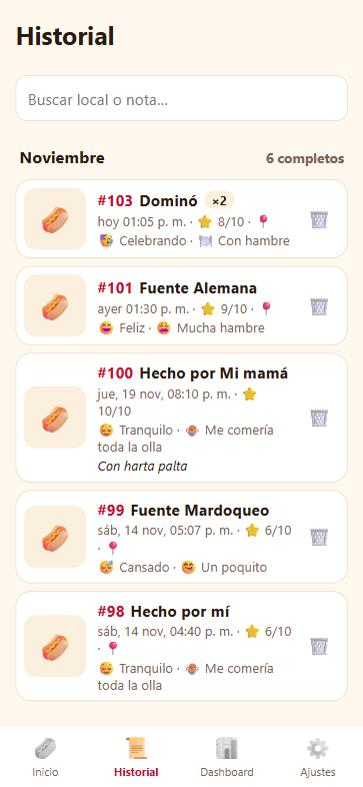 |
| "¿Quién lo preparó?" y la escala de hambre, de "Nada" a "Toda la olla". | Cada registro con su número del año; se puede editar o eliminar. |

## Dashboard

| Resumen y gráfico | Hambre y emociones | Mapa y ranking |
|:-:|:-:|:-:|
| 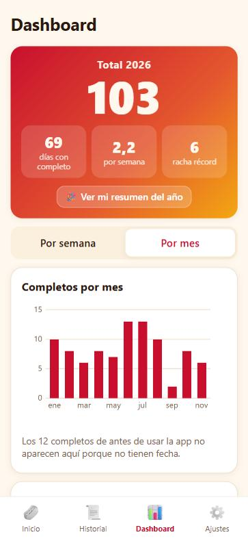 | 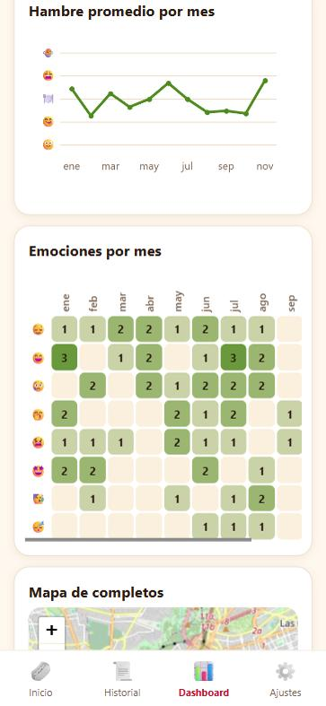 | 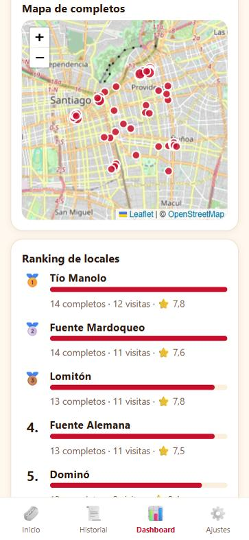 |
| Gráficos por semana o por mes. | Hambre promedio y emociones por periodo. | Mapa (OpenStreetMap) y ranking con nota promedio. |

## Mi top 5

| Ranking | Reseñas y mapa de calor |
|:-:|:-:|
| 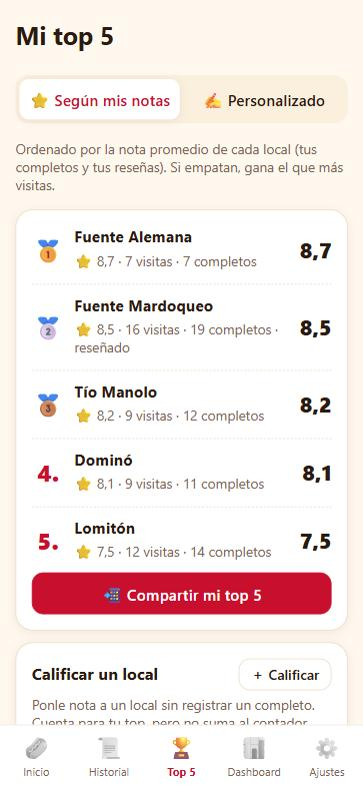 | 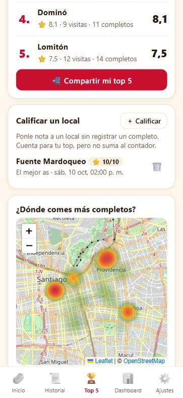 |
| Según tus notas (desempata por visitas) o personalizado. | Califica locales sin registrar un completo; el mapa de calor muestra dónde comes más. |

| Boleta "Mi top 5" | Plantilla "Mi completo favorito" |
|:-:|:-:|
| 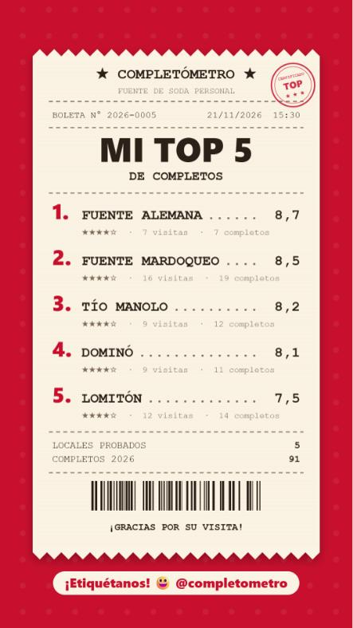 | 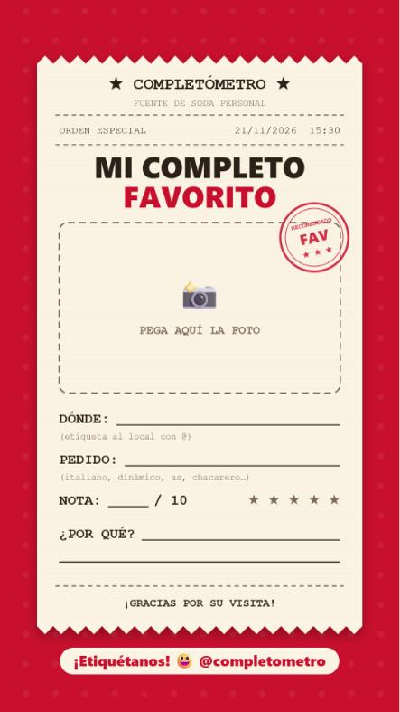 |
| Para compartir en historias. Si faltan locales, deja líneas en blanco. | En blanco: pon tu foto, escribe sobre las líneas y etiqueta al local. |

## Resumen del año

| En la app | Imagen para historias de Instagram |
|:-:|:-:|
| 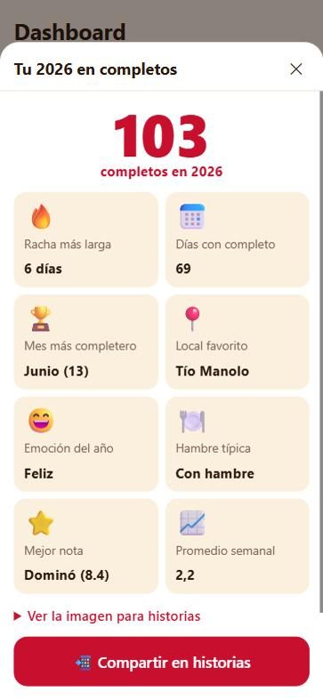 | 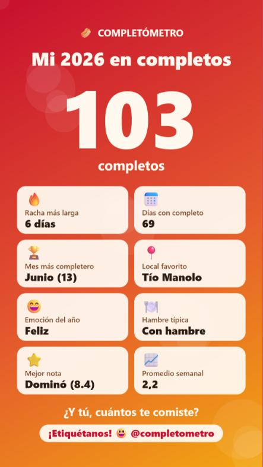 |

## Ajustes

| Respaldo en Google Drive | Acerca de |
|:-:|:-:|
| 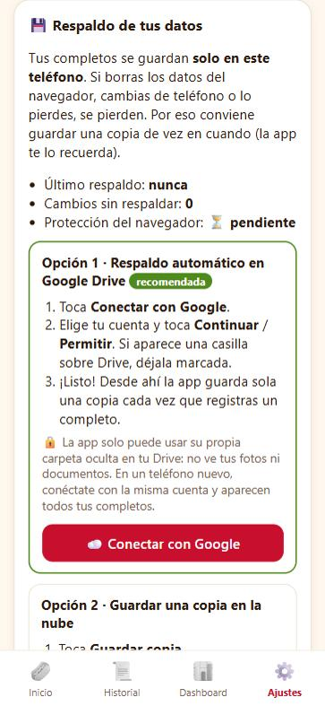 | 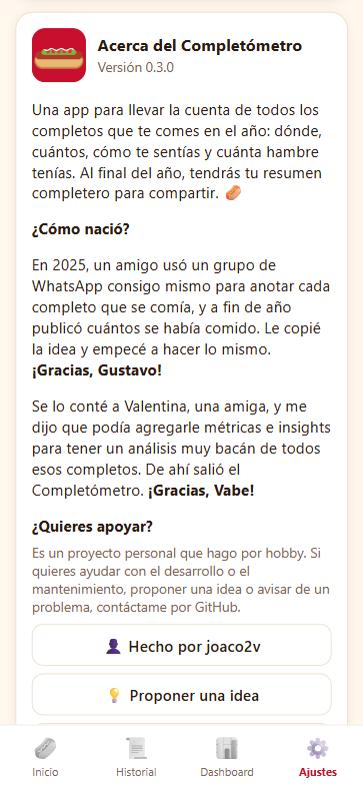 |
